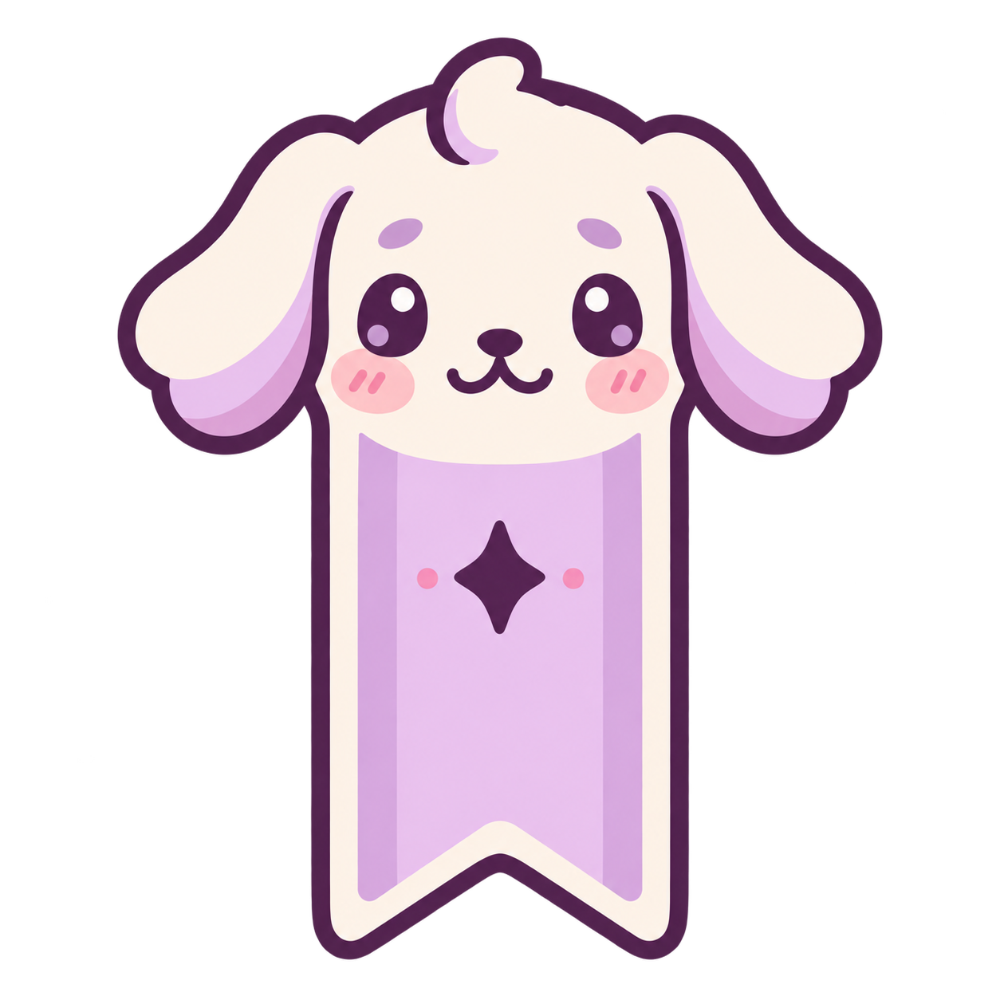

# Suwa puppy logo concepts

Created with the built-in image generation tool. All four concepts are retained.
The selected logo is `03-curled-puppy.png`, copied to
`packaging/app.suwa.Suwa.png` for the application and desktop launcher.

## 04-curled-manga


Based on `03-curled-puppy.png`, using `01-book-puppy.png` as the manga book reference.

Prompt:

```text
Use case: precise-object-edit / logo-brand
Asset type: revised Suwa puppy app logo concept, transparent PNG.
Input images: Image 1 (03-curled-puppy.png) is the edit target. Image 2 (01-book-puppy.png) is a reference ONLY for the open manga book and its visible comic panels.
Primary request: keep the curled-up sleeping puppy from Image 1, but replace its closed hardcover book with an OPEN PAPERBACK MANGA volume like the open comic in Image 2. Keep the puppy curled in the same cozy pose, resting its cheek and front paw against the top of the open manga. The open spread should show a few clearly visible manga panels, with simple lavender line-art faces/scenery and panel borders. Thin flexible paperback covers, a soft curved page gutter, lightweight paper edges; not a hardcover. Adapt only the lower book area and the immediate contact edges as needed.
Invariants: preserve Image 1's exact puppy identity, sleepy eyes, fluffy head and ears, lilac heart markings on ears, cream fur, pink blush, curled tail silhouette, pose, proportions, lavender/pink/plum palette, outline weight, rendering style and square framing. Do not borrow the awake puppy, bows or accessories from Image 2. Retain the tiny peaceful expression.
Constraints: genuinely transparent background, generous margin, single centered mascot, no text, no lettering, no watermark. Preserve the original logo; this is a separate new variant.
```

## 01-book-puppy


Prompt:

```text
Use case: logo-brand
Asset type: Suwa Linux manga reader logo concept, square app icon
Primary request: a cute puppy themed logo for Suwa. A tiny floppy-eared puppy peeks over an open manga book, front view, paws resting on the pages. Friendly sleepy eyes, tiny nose, simple appealing silhouette. Soft plum outlines, cream fur, lavender and blush accents to fit Suwa's pastel goth UI.
Style/medium: polished flat mascot logo, clean vector-like edges, a few broad shapes, readable at 48 pixels, generous padding.
Scene/backdrop: genuinely transparent background.
Constraints: single centered logo, no text, no lettering, no watermark, no mockup, no shadows outside mark.
```

## 02-puppy-bookmark



Prompt:

```text
Use case: logo-brand
Asset type: Suwa Linux manga reader logo concept, square app icon
Primary request: a cute puppy themed logo for Suwa. A floppy-eared puppy face incorporated into a manga bookmark silhouette: softly rounded tall bookmark with a small notched bottom and a puppy face near the top, two soft ears curling outward. A sweet calm expression and tiny blush cheeks. Soft plum outlines, cream fur, lavender and blush accents to fit Suwa's pastel goth UI.
Style/medium: minimal flat mascot emblem, clean vector-like edges, broad simple shapes, readable at 48 pixels, generous padding.
Scene/backdrop: genuinely transparent background.
Constraints: single centered logo, no text, no lettering, no watermark, no mockup, no shadows outside mark.
```

## 03-curled-puppy


Prompt:

```text
Use case: logo-brand
Asset type: Suwa Linux manga reader logo concept, square app icon
Primary request: a cute puppy themed logo for Suwa. A little floppy-eared puppy curled cozily around a closed manga volume, creating a compact rounded silhouette. The puppy's cheek rests on the book, tiny nose and sleepy content eyes; one little paw visible. Soft plum outlines, cream fur, lavender and blush accents to fit Suwa's pastel goth UI.
Style/medium: polished flat mascot logo, clean vector-like edges, a few broad shapes, readable at 48 pixels, generous padding.
Scene/backdrop: genuinely transparent background.
Constraints: single centered logo, no text, no lettering, no watermark, no mockup, no shadows outside mark.
```

